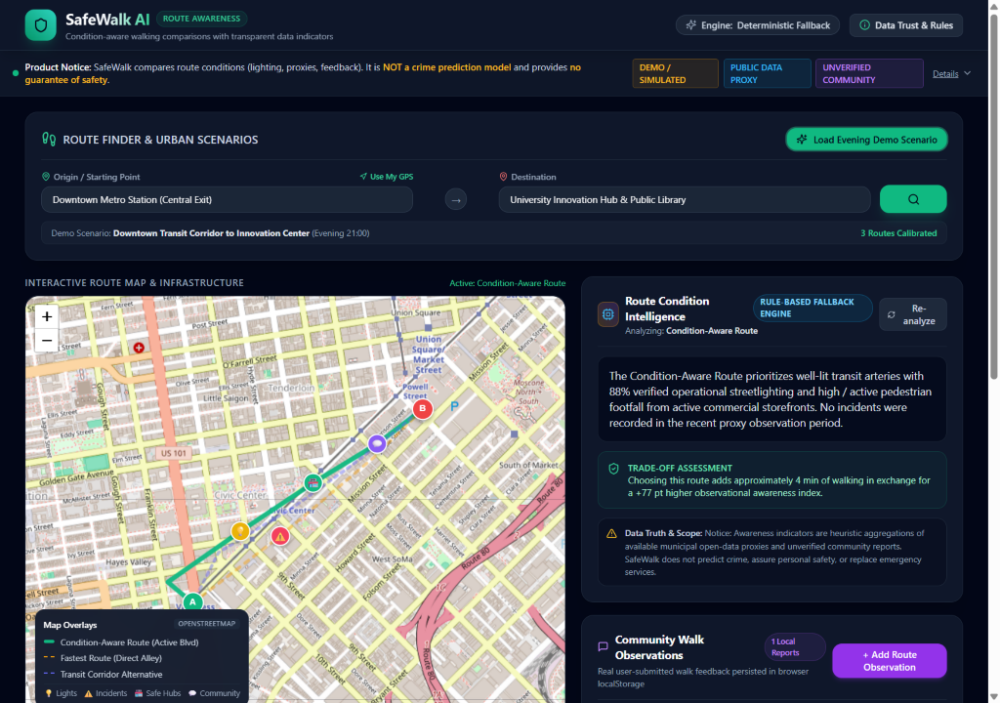

# SafeWalk AI — Urban Route Awareness

**SafeWalk AI is a route-awareness prototype that compares walking-route options using clearly labelled demonstration indicators for street lighting, reported incidents, pedestrian activity, and community observations.** It helps people inspect route trade-offs; it does not predict crime or guarantee personal safety.

> **Important:** SafeWalk AI is a competition prototype. The route-condition datasets and route corridors shown in the included demo scenario are simulated or calibrated demonstration data. The displayed index is a deterministic heuristic, not a measured safety score, crime probability, or assurance that a route is safe.



## At a glance

- **Application:** Next.js 14.2.15, React 18, TypeScript
- **UI:** Tailwind CSS and Lucide React
- **Map:** Leaflet with OpenStreetMap raster tiles
- **Route comparison:** Pre-calibrated demonstration corridors and deterministic application-level heuristics
- **AI explanation:** Optional server-side Gemini integration with a deterministic fallback
- **Feedback:** Browser `localStorage`; observations are device-local and unverified
- **Deployment target:** Vercel, with the application root set to `app/`

## What the prototype demonstrates

1. **Route finder and demo scenario** — load the prepared evening corridor scenario or enter origin and destination text for the prototype's route-search experience.
2. **Interactive map** — inspect the OpenStreetMap basemap, route overlays, and illustrated infrastructure or observation markers.
3. **Three route options** — compare the condition-aware route, fastest route, and transit alternative using their displayed travel estimates and demonstration indicators.
4. **Transparent route-awareness index** — inspect the deterministic heuristic breakdown rather than relying on an unexplained AI-generated safety probability.
5. **Route explanation** — read a plain-language summary of the supplied route factors. When Gemini is unavailable or no key is configured, the application uses its rule-based fallback.
6. **Post-journey feedback** — submit observations about lighting, activity, and obstructions; the prototype displays them in a community-observation feed.
7. **Data disclosures** — inspect the in-app explanation of data provenance, simulated inputs, unverified feedback, and product limitations.

### Demonstration scenario

The prepared scenario includes three calibrated route alternatives. The following figures are **illustrative values from that scenario only**, not live navigation results or real-world safety measurements:

| Demonstration route | Walk estimate | Distance | Route-awareness index |
|---|---:|---:|---:|
| Condition-Aware Route | 18 min | 1,420 m | 92/100 |
| Fastest Route | 14 min | 1,150 m | 15/100 |
| Transit Alternative | 16 min | 1,280 m | 68/100 |

The index is a bounded, deterministic heuristic used to demonstrate how supplied indicators can be compared. It is **not** a probability, a validated risk model, or a recommendation that any route is safe. A higher index must not be interpreted as a guarantee of personal safety.

## Screenshots and evidence

The repository includes screenshots captured during the competition verification run:

| Evidence | Screenshot | What it shows |
|---|---|---|
| S01 | [Main application](submission/evidence/screenshots/S01_main_application.png) | Landing view, route finder, product notice, and map |
| S02 | [Map and route comparison](submission/evidence/screenshots/S02_map_and_route_comparison.png) | Route overlays and comparison cards |
| S03 | [Expanded formula](submission/evidence/screenshots/S03_expanded_formula.png) | Deterministic heuristic breakdown |
| S04 | [Transparency disclosures](submission/evidence/screenshots/S04_transparency_disclosures.png) | Data classifications and disclosures |
| S05 | [Journey feedback form](submission/evidence/screenshots/S05_journey_feedback_form.png) | Post-journey observation form |
| S06 | [Submitted community observation](submission/evidence/screenshots/S06_community_feedback_submitted.png) | Feedback shown with an unverified label |
| S07 | [Mobile layout](submission/evidence/screenshots/S07_mobile_responsive.png) | Responsive layout at a 390 px viewport |

## Data provenance and trust boundaries

SafeWalk deliberately distinguishes map data, simulated demonstration inputs, and user-submitted observations.

| Information shown | Prototype treatment | Important limitation |
|---|---|---|
| Map geometry and tiles | OpenStreetMap data and standard public raster tiles | Map coverage and accuracy depend on OpenStreetMap; this does not validate the route-condition indicators |
| Street-lighting indicator | Simulated demonstration proxy | Not measured lux values, verified fixture status, or a live municipal lighting feed |
| Reported-incident indicator | Simulated incident sample | Not a police feed, verified crime dataset, or statement that an area is crime-free |
| Pedestrian activity | Demonstration activity proxy | Not live footfall measurement, people tracking, or surveillance |
| Community observations | User-submitted entries marked **UNVERIFIED** | Stored in the browser's `localStorage`; not centrally moderated or synchronised across users |
| Route geometry and search | Pre-calibrated demonstration corridors and simulated search resolution | Not live turn-by-turn routing or a live third-party geocoding service |

**OpenStreetMap attribution:** © [OpenStreetMap contributors](https://www.openstreetmap.org/copyright). The map tiles are provided by the OpenStreetMap tile service; use is subject to its [tile usage policy](https://operations.osmfoundation.org/policies/tiles/).

### Known limitations

- The prepared route corridors and condition values are demonstration data. They should not be used for real-world navigation or personal-safety decisions.
- Custom origin/destination search uses simulated resolution rather than a live geocoding provider.
- Feedback is stored locally in the current browser. It is not a shared community database.
- Feedback text can persist after refresh, but dynamically added map markers are re-initialised from the static points when the page reloads.
- The route-awareness heuristic is a prototype calculation and has not been statistically validated.
- Gemini is optional. The core demonstration is designed to remain available through the deterministic fallback when the API key is absent or the service is unreachable.
- The prototype does not replace emergency services, local guidance, or a person's own judgement.

## Technology and architecture

SafeWalk is implemented as a single Next.js application. The UI, server-side route handlers, and optional AI integration are kept in the same application rather than split into separate services.

```text
SafeWalk-AI-VibeForge-2026/
├── app/                 # Next.js application
│   ├── app/             # App Router pages and API route handlers
│   ├── components/      # UI and map components
│   ├── data/            # Calibrated demonstration scenario data
│   ├── public/          # Static assets
│   ├── package.json
│   └── package-lock.json
├── docs/                # Product brief, architecture, API and data-trust notes
├── prompts/             # Competition build prompts and operating instructions
├── submission/          # Presentation, demo, disclosures and evidence logs
└── README.md
```

The main server-side API routes are:

- `POST /api/ai/route-explanation` — produces a route-condition explanation from supplied structured factors; uses the deterministic fallback when Gemini is unavailable or not configured.
- `POST /api/ai/classify-feedback` — classifies a submitted feedback item; the prototype also supports a rule-based fallback.

The browser does not need a Gemini key. When enabled, the key is read by the server from the `GEMINI_API_KEY` environment variable.

## Run locally

### Prerequisites

- Node.js compatible with the dependencies in `app/package.json`
- npm
- Internet access for loading the OpenStreetMap basemap tiles

### Install and start the development server

From the repository root:

```bash
cd app
npm ci
npm run dev
```

Open the local URL printed by Next.js (normally `http://localhost:3000`). If that port is already in use, Next.js may select another available port.

### Create a production build

From `app/`:

```bash
npm run build
npm run start
```

The production start script and port are defined by the application's package scripts and runtime configuration. The competition verification run used `http://localhost:3001`.

## Optional Gemini configuration

Gemini is optional; leave it unconfigured to use the deterministic fallback.

To enable the server-side integration locally:

1. Create an API key in [Google AI Studio](https://aistudio.google.com/app/apikey).
2. Create `app/.env.local` (do not commit this file).
3. Add:

   ```dotenv
   GEMINI_API_KEY=your_key_here
   ```

4. Restart the local development server.

Never place the key in client-side code, a `NEXT_PUBLIC_` variable, screenshots, prompt logs, or Git. The repository's `.gitignore` excludes local environment files. For a hosted deployment, configure `GEMINI_API_KEY` in the hosting provider's server-side environment-variable settings and redeploy. No environment variable is required for the fallback experience.

## Deploy to Vercel

1. Push this repository to GitHub.
2. In Vercel, import `SafeWalk-AI-VibeForge-2026`.
3. Set **Root Directory** to `app`.
4. Select the **Next.js** framework preset and keep the detected install/build settings unless Vercel reports a specific issue.
5. Leave environment variables empty for the deterministic fallback, or add `GEMINI_API_KEY` as a server-side environment variable to enable Gemini.
6. Deploy and test the resulting public URL.

The repository root contains the competition documentation and evidence; the deployable Next.js application is in `app/`.

## Competition documentation

The `submission/` directory contains the project's presentation content, demo script, AI interaction log, resource disclosures, screenshot evidence log, final submission checklist, and Graphify evidence log. The `docs/` directory contains the product brief, architecture, minimal API contract, data-trust rules, and build/deployment planning notes.

The project distinguishes the pre-contest concept exploration from the fresh competition implementation in its disclosure documentation. Any reuse or organiser-approval claim should be read from the documented evidence rather than inferred from this README.

## Responsible use

SafeWalk AI is an experimental route-awareness demonstration. Do not use its simulated indicators, heuristic index, or sample routes to decide whether a real place is safe. The project does not provide emergency response, crime prediction, or a guarantee of safer travel.

## License

No open-source license is currently included in this repository. Public visibility on GitHub does not, by itself, grant permission to reuse, modify, or redistribute the code. Add an explicit license only if the project owners intend to grant those rights.
